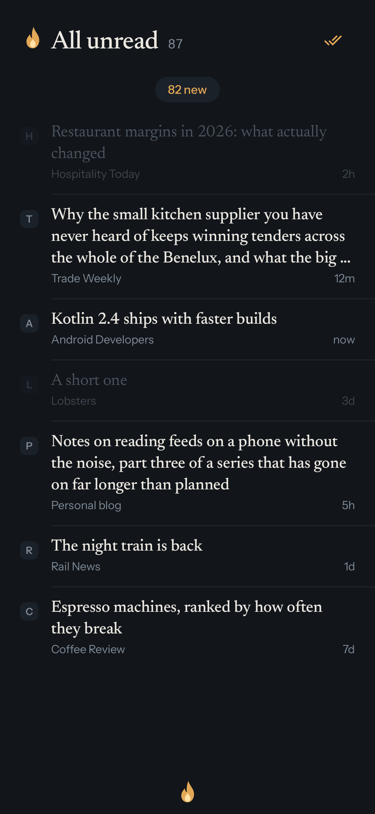
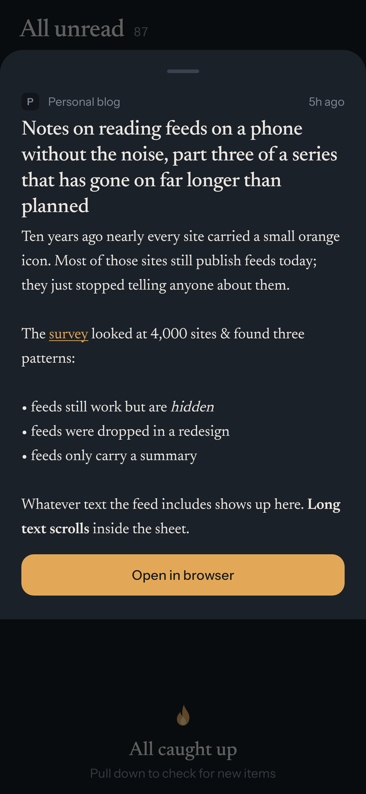
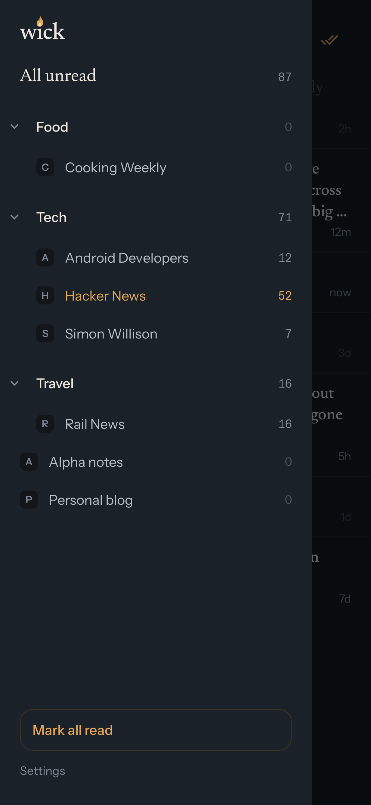

<div align="center">


# Wick

**A calm, dark RSS reader for Android.**<br>
Headlines from your own feed server, read top to bottom.

[](https://github.com/bardesss/wick/releases/latest)
[](https://github.com/bardesss/wick/actions/workflows/ci.yml)
[](#requirements)
[](LICENSE)

<a href="https://apps.obtainium.imranr.dev/redirect?r=obtainium://add/https://github.com/bardesss/wick"></a>
<a href="https://github.com/bardesss/wick/releases/latest"></a>

<br><br>

&nbsp;&nbsp;
&nbsp;&nbsp;


</div>

## Why Wick

Wick shows one list of headlines. You read it top to bottom, and items drop off once you have seen them. It connects to the feed server you already run, so your feeds, folders and read state stay there.

## Features

- The list shows titles only, with each feed's icon and the item's age. No thumbnails or previews compete for attention.
- Items you scroll past are marked read, so the list always holds what you have not seen yet. When you reach the end, one button checks for new items.
- Tap an item to open the article in the in-app browser or your default app, as you choose in Settings. Swipe right to see the feed's own text in a sheet, and swipe left to mark an item read or unread.
- A drawer lists your server's folders and feeds with their unread counts, and can mark everything read. Folders fold away, and feeds with nothing unread can be hidden.
- Read marks are queued on the phone and sent once the server is reachable again, so a flaky VPN loses nothing.
- An hourly background sync keeps the list fresh. There are no notifications, ever.
- Wick is native Kotlin and Jetpack Compose on a local database, and the APK is about 2 MB.
- There are no accounts, analytics, ads or trackers. Wick talks to your own server, and articles open in your browser. The image at the top of a summary is the one exception: it loads from the article's site, and you can turn it off in Settings.
- Feed icons on your server need your API key, and the server only takes it as part of the address. That means the key shows up in your server's access logs, and in the logs of a proxy in front of it.
- The look is dark by design: warm candlelight accents on a near-black background, easy on the eyes at night.

## Requirements

- Android 8.0 or newer.
- A feed server that offers the Google Reader API over https. Tested with CommaFeed.
- The Google Reader API URL of that server. It often ends in `/rest/googlereader` or `/api/greader.php`, and some servers use the bare address, like `https://your.server`. If the address you enter has no API, Wick tries those two paths after it.
- Your username and the API key from your profile on that server.

## Install

The easiest way to install and update Wick is [Obtainium](https://obtainium.imranr.dev/). Tap the badge above on your phone, or add an app in Obtainium with this URL:

```
https://github.com/bardesss/wick
```

You can also download the APK from the [latest release](https://github.com/bardesss/wick/releases/latest). Every release is signed with the same key, so updates install over the previous version.

## First run

Enter the Google Reader API URL of your server, your username and your API key. Wick then loads your unread items.

## Building from source

You need JDK 21 and the Android SDK.

```
./gradlew :app:assembleDebug
```

## License

GPL-3.0. See [LICENSE](LICENSE).
